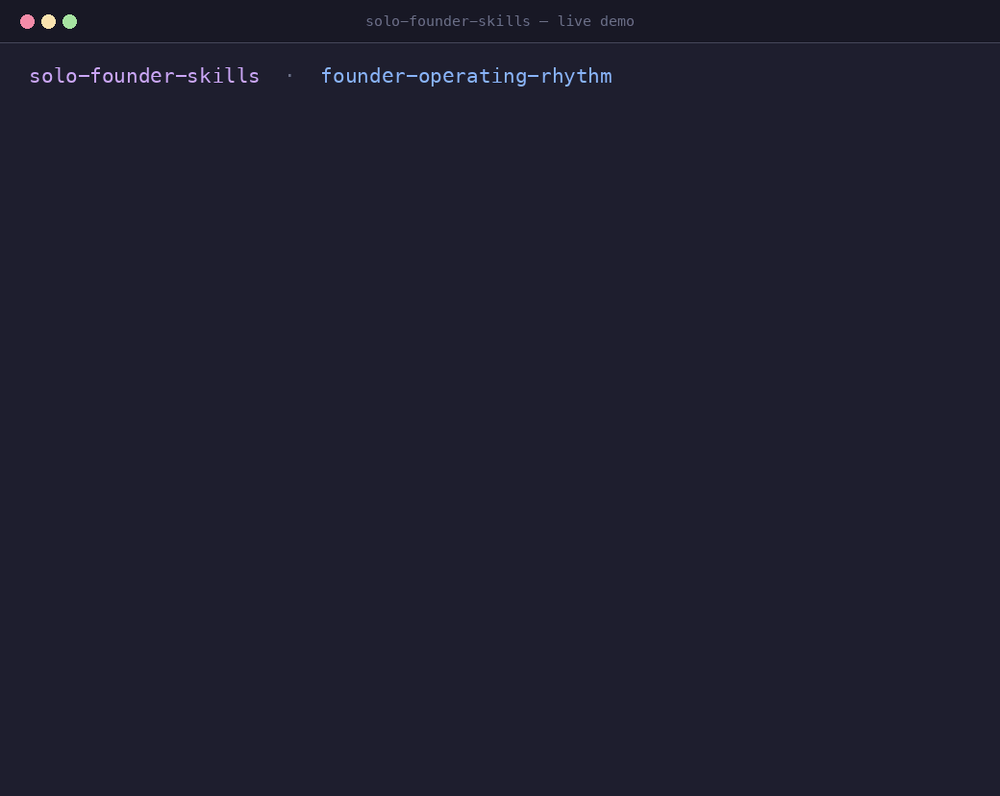

<h1 align="center">Solo Founder Skills</h1>
<p align="center"><em>Agent Skills that turn a general-purpose coding agent into a solo-founder operator.</em></p>

<p align="center">
  
  
  
</p>

A small, opinionated pack of [Agent Skills](https://agentskills.io) for people who run a software business alone — the founder who is also the product manager, the marketer, the support desk, and the bookkeeper. Built on the open Agent Skills standard, so the same folders work in Claude Code, OpenAI Codex, Gemini CLI, Cursor, VS Code / Copilot, and OpenCode.

The design is deliberately small. Research on solo builders in 2026 points the same way: building got cheap, everything *around* building (distribution, retention, trust, legal/finance) did not. So this pack covers the whole lifecycle with **twelve skills, one per "hat"** — each biased toward **verifiable** output (a script that computes a number) or **structural** output (a file you edit), not confident prose generated from nothing.

Start with [`solo-founder-os`](skills/solo-founder-os) — it boots the shared workspace, writes your `founder/context.md`, and routes you to the right skill for the moment.

<p align="center">
  
</p>
<p align="center"><em>Ask in plain English; the skill runs its own script and answers with a number — <a href="skills/founder-operating-rhythm">founder-operating-rhythm</a>.</em></p>

## The pack

**Route**
| Hat | Skill | The outcome it produces |
| :-- | :-- | :-- |
| Concierge | [`solo-founder-os`](skills/solo-founder-os) | Bootstraps `founder/`, diagnoses the real job, routes to one skill, reports status. |

**Find, scope, and price**
| Hat | Skill | The outcome it produces |
| :-- | :-- | :-- |
| Validator | [`idea-validation`](skills/idea-validation) | Typed, falsifiable assumptions + a Mom Test interview guide + competitor scan + a go/no-go brief. |
| Product | [`mvp-scoping`](skills/mvp-scoping) | The 90/10 MVP scope, exit criteria, a boring-stack decision, and an MVP spec. |
| Pricing | [`pricing-strategy`](skills/pricing-strategy) | A value metric, 2–3 tiers, WTP research, and a pricing page. |

**Get found**
| Hat | Skill | The outcome it produces |
| :-- | :-- | :-- |
| Positioning | [`positioning-and-messaging`](skills/positioning-and-messaging) | Category, one-line positioning, a landing hero, value props, and a messaging guide. |
| Marketer | [`go-to-market-launch`](skills/go-to-market-launch) | A launch plan and assets, plus a compounding distribution engine. |
| Publisher | [`content-and-seo-engine`](skills/content-and-seo-engine) | A pillar + supporting content program, SEO/GEO, and an editorial calendar. |

**Measure, learn, and keep**
| Hat | Skill | The outcome it produces |
| :-- | :-- | :-- |
| Analyst | [`product-metrics`](skills/product-metrics) | 3–5 instrumented metrics and a weekly digest that ends in one action. |
| Scientist | [`experiments-and-growth`](skills/experiments-and-growth) | A disciplined experiment log and scale/iterate/kill decisions against the binding constraint. |
| Support | [`support-and-onboarding`](skills/support-and-onboarding) | A solo support system, help docs, and an onboarding-to-aha sequence. |
| Operator | [`founder-operating-rhythm`](skills/founder-operating-rhythm) | A weekly rhythm, prioritisation, a runway model, a decision log, and ops/legal checklists. |
| Fundraiser | [`fundraising-and-investor-updates`](skills/fundraising-and-investor-updates) | A raise narrative, deck outline, data room, dilution math, and monthly investor updates. |

## Install

**Claude Code (plugin marketplace):**

```
/plugin marketplace add restuhaqza/solo-founder-skills
/plugin install founder-core@solo-founder-skills
```

**Manual (any Agent Skills client)** — copy the folders you want into your skills directory:

```bash
# Claude Code / Cursor / Copilot / Gemini CLI
cp -r skills/* ~/.claude/skills/

# OpenCode
cp -r skills/* ~/.config/opencode/skills/

# Codex / generic Agent Skills clients
cp -r skills/* ~/.agents/skills/
```

Copy individual skills if you only want a subset — they are self-contained.

## How they compose

The skills share one workspace: a `founder/` folder at your project root. Each writes into its own subfolder and reads a short shared brief.

```
founder/
├── context.md          # product one-liner, ICP, stage, north-star, stack (shared)
├── validation/         # idea-validation
├── product/            # mvp-scoping
├── pricing/            # pricing-strategy
├── gtm/                # positioning-and-messaging, go-to-market-launch, content-and-seo-engine
├── metrics/            # product-metrics
├── growth/             # experiments-and-growth
├── support/            # support-and-onboarding
├── ops/                # founder-operating-rhythm
└── fundraising/        # fundraising-and-investor-updates
```

They hand off in a loop, not a line: validate → scope → price → position → launch → publish → measure → experiment → support → operate → (new evidence) → validate. Each skill names the sibling it hands to, and `solo-founder-os` can route you when you are not sure.

**Which one do I want?**

- "Where do I even start?" → `solo-founder-os`
- "Is this idea worth building?" → `idea-validation`
- "What's the smallest thing I can ship?" → `mvp-scoping`
- "How much should I charge?" → `pricing-strategy`
- "How do I describe this / write the headline?" → `positioning-and-messaging`
- "How do I get users?" → `go-to-market-launch`
- "How do I keep getting found?" → `content-and-seo-engine`
- "What should I measure / my churn is high?" → `product-metrics`
- "Why isn't growth moving?" → `experiments-and-growth`
- "Support is eating my day" → `support-and-onboarding`
- "I'm overwhelmed / am I default dead?" → `founder-operating-rhythm`
- "Should I raise, and how do I update investors?" → `fundraising-and-investor-updates`

## Results

The pack ships with an evaluation, not a claim. Each skill is tested with a realistic **trap prompt** — the kind of request that makes a general-purpose model fail (asks for jargon, for 500 thin pages, to ship on a three-day peek, to skip a bad-news update) — run **with** and **without** the skill, and graded by a separate agent that reads only the output files.

Across five iterations and **96 graded runs**:

- **With the skill: 100% of assertions passed on every skill.**
- **Without: 54% on average**, and worse on the strongest traps.
- The loop found and fixed **two real defects** — a scoring false positive in the headline linter, and a missing "growth rate at which the runway verdict flips" output.

| Skill | The trap it must avoid | With | Without | Δ |
| :-- | :-- | --: | --: | --: |
| `solo-founder-os` | routes to **one** skill, not a menu | 1.00 | 0.20 | +0.80 |
| `pricing-strategy` | reprices without ignoring existing customers | 1.00 | 0.00 | +1.00 |
| `go-to-market-launch` | keeps outbound in the founder's hands | 1.00 | 0.30 | +0.70 |
| `positioning-and-messaging` | refuses "revolutionary / all-in-one for everyone" | 1.00 | 0.57 | +0.43 |
| `content-and-seo-engine` | refuses 500 thin programmatic pages | 1.00 | 0.58 | +0.42 |
| `mvp-scoping` | guards the 90/10 scope against creep | 1.00 | 0.60 | +0.40 |
| `product-metrics` | a weekly digest that ends in **one action** | 1.00 | 0.60 | +0.40 |
| `support-and-onboarding` | no AI chatbot at 30 customers | 1.00 | 0.60 | +0.40 |
| `idea-validation` | separates compliments from evidence | 1.00 | 0.70 | +0.30 |
| `experiments-and-growth` | refuses shipping on a 3-day peek | 1.00 | 0.70 | +0.30 |
| `fundraising-and-investor-updates` | sends the bad-news update, does not skip it | 1.00 | 0.80 | +0.20 |
| `founder-operating-rhythm` | runway verdict **and** the growth rate it flips at | 1.00 | 0.80 | +0.20 |

Full method, per-iteration history, and caveats: [`docs/benchmark.md`](docs/benchmark.md).

## What are Agent Skills?

A skill is a folder with a `SKILL.md` file: YAML metadata (`name`, `description`) plus Markdown instructions and optional `scripts/`, `references/`, and `assets/`. Agents load only the name and description at startup, activate the full skill when a task matches, and load bundled files on demand — so you can keep the pack installed at almost no context cost.

```
skills/<name>/
├── SKILL.md        # required: frontmatter (name, description) + instructions
├── scripts/        # optional: runnable code (Python 3 stdlib; runs without entering context)
├── references/     # optional: docs loaded on demand (one level deep, with a Contents list)
├── assets/         # optional: fill-in templates
└── evals/evals.json
```

## A note on boundaries

These skills intentionally do **not** make the calls that are yours to make. In particular they will prepare — never send or sign — the following: the go / no-go / pivot / kill call, any outbound or investor message (cold email, community post, pitch, update), and any legal, tax, entity, accounting, or investment action. Every skill that touches those says so.

## Development

See [`docs/SKILL-STANDARDS.md`](docs/SKILL-STANDARDS.md) for the house style, [`template/SKILL.md`](template/SKILL.md) for a copy-paste scaffold, and [`scripts/validate.py`](scripts/validate.py) for the repo checker. The two source research reports live in [`docs/research/`](docs/research).

To add a skill:

1. Create `skills/<kebab-case-name>/SKILL.md` — the folder name must equal the `name` field.
2. Frontmatter: only `name`, `description`, `license`, `metadata` (optional `compatibility`).
3. Keep the body under ~500 lines; move detail into `references/` with a "read when…" pointer.
4. Prefer a bundled, non-interactive, stdlib-only script over instructions an agent would have to improvise.
5. Add `evals/evals.json` with at least three realistic prompts.

Then run `python3 scripts/validate.py` and make it green.

Quality bar: a skill must capture a *real workflow with real edge cases*, not generic advice an LLM already knows.

## Security

Skills contain instructions and can ship executable code. Install only from sources you trust, read a skill's `SKILL.md`, `scripts/`, and `references/` before enabling it, and never disable permission prompts outside a sandbox. Review updates by diff, like any dependency.

## License

MIT — see [`LICENSE`](LICENSE).
